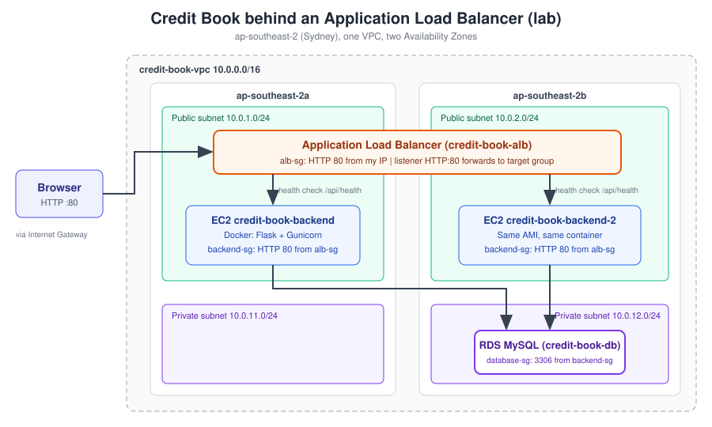
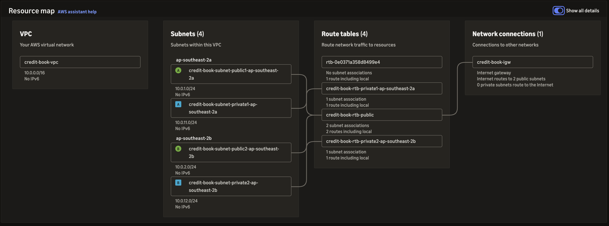
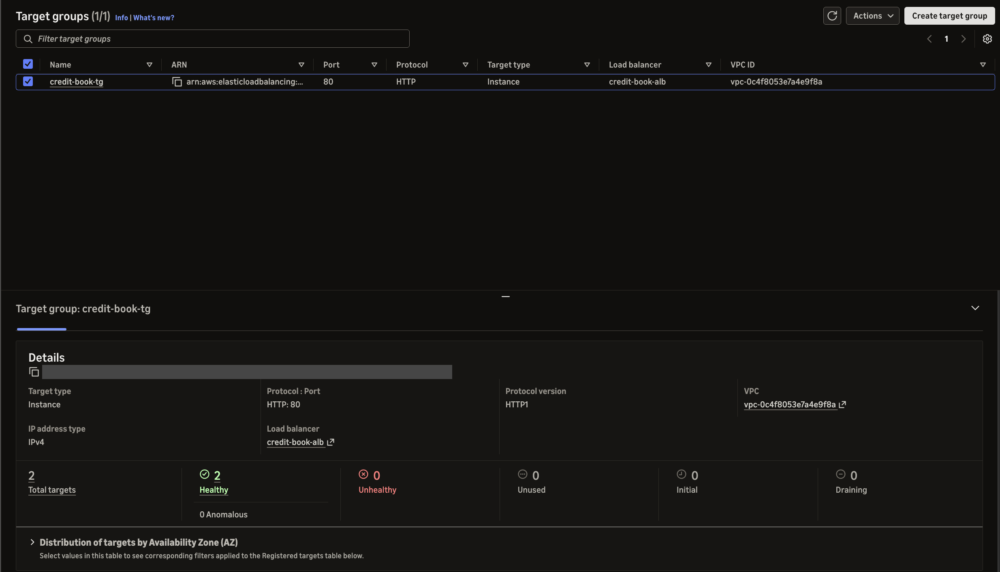
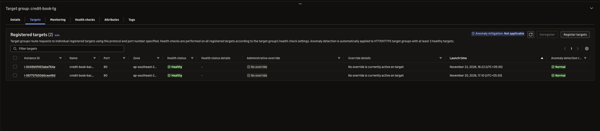
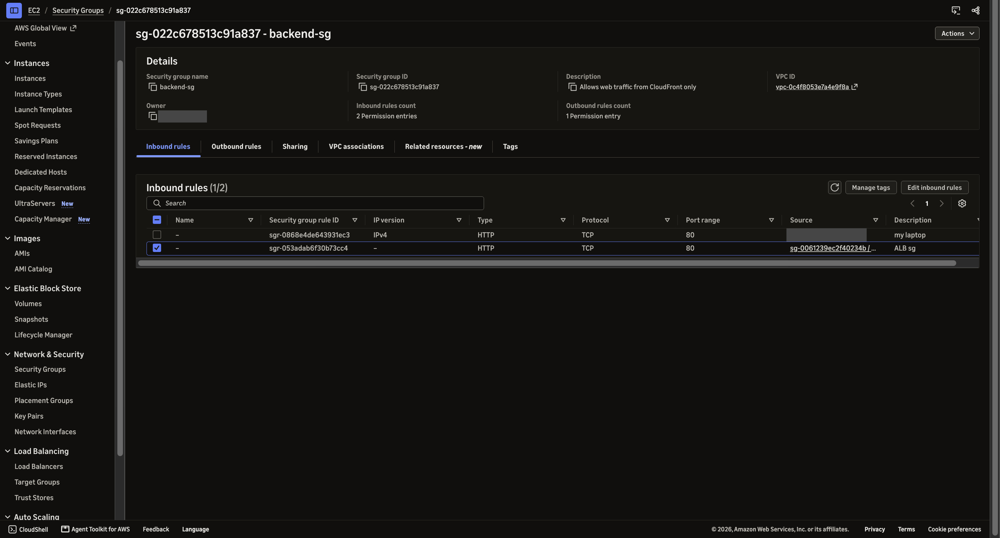

<h1 align="center">AWS High-Availability Lab: ALB, Two AZs, Health Checks</h1>

<b>Two copies of a Flask app behind an Application Load Balancer, built and torn down by hand on AWS.</b> 
A short, time-boxed lab that extends my <a href="https://github.com/MirMohammadHashim/credit-book">Credit Book</a> three-tier project.

  

## What this lab shows

- **Load balancing.** An internet-facing Application Load Balancer (ALB) spreads requests across two EC2 servers in two Availability Zones.
- **Health checks.** The target group checks `GET /api/health` on each server and only sends traffic to healthy ones.
- **Security group chaining.** `backend-sg` accepts HTTP from the ALB's security group (`alb-sg`), not from an IP range.
- **Repeatable servers.** The second server was launched from an AMI of the first, so it started identical.
- **Cost discipline.** Everything was deleted after the test.

> **Honest scope:** this was a lab I ran once and removed, not a permanent environment. The standing project still runs on one server. See [Limitations](#limitations).

## What I built

| Piece | Setting |
|---|---|
| Region / network | `ap-southeast-2`, `credit-book-vpc`, two public subnets (2a, 2b), two private subnets, Internet Gateway, no NAT Gateway |
| Server image | AMI taken from the working backend (Docker, app code, container that restarts on boot) |
| Servers | Two EC2 instances, one per Availability Zone (the second launched as `t3.micro`), same IAM role (`ec2-backend-role`) |
| Target group | `credit-book-tg`: HTTP 80, health check `GET /api/health`, success code 200, interval 30 s, timeout 5 s, healthy after 5 passes, unhealthy after 2 failures |
| Load balancer | `credit-book-alb`: internet-facing, IPv4, both public subnets, listener HTTP:80 forwarding to `credit-book-tg` |
| Firewall | `alb-sg`: HTTP 80 from my IP only. `backend-sg`: HTTP 80 from `alb-sg` (plus my IP for direct testing while building). `database-sg`: MySQL 3306 from `backend-sg` only |
| Database | One RDS MySQL instance in the private subnets, shared by both servers |

## Why the app needed no code changes

- Login uses JWT, so any server can verify any token. No sticky sessions were needed.
- Both servers read the same secrets from Parameter Store and use the same database.

## Evidence

**Network layout (VPC resource map)**

**Target group: 2 healthy targets, 0 unhealthy**

**Targets tab: one server in each Availability Zone, both Healthy**

**`backend-sg` rule allowing the ALB's security group, beside my own IP rule**

_Account ID and IP addresses are blurred._

## What I tested

- Opened the ALB DNS name and the Credit Book app loaded through it.
- Stopped one server. The target group stopped using it and showed its state as **Unused**. A stopped instance shows as Unused, not Unhealthy.
- Started it again and watched it return to Healthy.

## Problems I hit

| Problem | Cause | Fix |
|---|---|---|
| Launch wizard defaulted to a new security group with SSH (22) open to `0.0.0.0/0` | The wizard's default | Chose the existing `backend-sg` |
| New server would have had no AWS permissions | An AMI does not carry the IAM instance profile | Attached `ec2-backend-role` under Advanced details |
| ALB returned **504 Gateway Timeout** | `backend-sg` only allowed my IP, so the ALB's requests were dropped | Added an inbound HTTP rule with `alb-sg` as the source |
| Stopped server showed **Unused**, not Unhealthy | Expected for a stopped instance | Read the target's health status details |

More detail in [docs/troubleshooting.md](docs/troubleshooting.md).

## Cost and teardown

An ALB bills by the hour plus capacity units, and the lab also ran a second server and two load balancer public IPs. I ran it for under two hours and deleted everything in this order: ALB, target group, second instance, AMI and its snapshot, `alb-sg`, and the `backend-sg` rule that referenced it. My own estimate is well under US$1 for the lab; I did not itemise the bill. Free-tier eligibility depends on the account, so check current prices before repeating it. See [docs/runbook.md](docs/runbook.md).

## Limitations

- Both servers are in **public subnets with public IPs** (no NAT Gateway to keep cost down). Production would put them in private subnets behind the ALB.
- **HTTP only.** No TLS. A real setup would use ACM and a domain.
- **No Auto Scaling.** The second server was created by hand from an AMI.
- Everything was built by hand in the console. The next step is to rebuild it in Terraform.
- One database instance is a single point of failure.

## Docs

| Document | What it covers |
|---|---|
| [docs/runbook.md](docs/runbook.md) | Step-by-step rebuild, settings, and teardown order |
| [docs/troubleshooting.md](docs/troubleshooting.md) | Problems, causes, fixes and lessons |
| [docs/interview-notes.md](docs/interview-notes.md) | Questions I should be able to answer about this lab |

## Author

**Mir Mohammad Hashim**, junior cloud engineer.

[LinkedIn](https://www.linkedin.com/in/mir-hashim-60a123311) · [GitHub](https://github.com/MirMohammadHashim) · [Credit Book project](https://github.com/MirMohammadHashim/credit-book)
